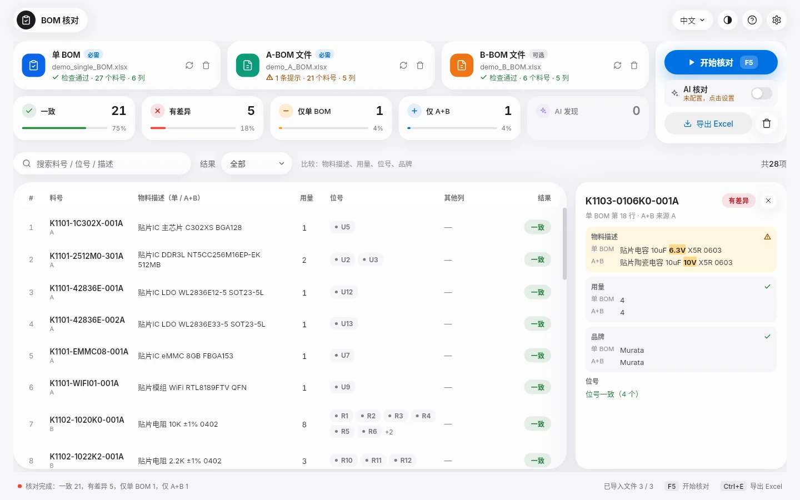

<div align="center">


# SMT-FAI

**SMT BOM 核对工具：单 BOM 与 A-BOM + B-BOM 按内容自动识别、逐料号核对、差异高亮，可选 AI 分析**

[](https://github.com/Marginal-Z/FAI-SMT/releases/latest)
[](https://github.com/Marginal-Z/FAI-SMT/actions/workflows/build.yml)


[官网](https://marginal-z.github.io/FAI-SMT/) · [使用教程](https://marginal-z.github.io/FAI-SMT/#tutorial) · [下载](https://github.com/Marginal-Z/FAI-SMT/releases/latest) · [更新记录](https://github.com/Marginal-Z/FAI-SMT/releases)



</div>

## 简介

SMT-FAI 用于 SMT 产线的 BOM 核对。导入作为基准的单 BOM，再导入 A-BOM（以及可选的 B-BOM）：A 与 B 合并后（同一料号用量相加、位号合并），与单 BOM 逐个料号比较物料描述、用量、位号和其他列，不一致的单元格填色、差异字符高亮。开启 AI 核对后，核对结果会交给你配置的大模型（OpenAI 兼容接口或 Anthropic）输出分析结果，并在表格中标记 AI 发现的问题。

本地核对完全在本机完成。只有开启 AI 核对时，核对数据才会发送到你在设置中配置的接口。

## 主要功能

| 功能 | 说明 |
| --- | --- |
| **三份文件** | 单 BOM（基准）、A-BOM 文件、B-BOM 文件（可选）；拖到卡片上或点击选择 |
| **按内容识别列** | 不依赖表头名称：位号列看位号写法，用量列看是否与位号数一致，料号列看唯一编码，描述列看较长文字；表头名称不同或没有表头也能读取；品名 + 规格等多列描述自动拼接 |
| **描述只比参数** | 物料描述只比较英文字母与数字组成的参数（阻值、容值、电压、精度、封装、型号等，区分大小写）；中文名称多一个字、少一个字或一长一短都视为一致 |
| **其他列精确比较** | 用量、位号以及两边都有的其他列（品牌、类别、厂商料号等）必须百分之百一致；名称不同或无表头的列按内容自动配对 |
| **差异直观** | 结果分为一致、有差异、仅单 BOM、仅 A+B；差异单元格填色、差异字符加粗高亮；位号列出缺少、多出及挂在其他料号下的 |
| **AI 核对** | 核对页一个开关打开；支持 OpenAI 兼容接口（OpenAI、DeepSeek、通义千问、Kimi、Ollama、vLLM 等）与 Anthropic；输出总结与逐条发现，AI 标记的料号用青色标识 |
| **Excel 报告** | 两边的值并排列出，结果按状态填色，差异单元格填黄色，AI 说明填青色；开启 AI 时附带「AI 分析」工作表 |
| **使用体验** | 中文 / English / ไทย；现代 / 工业两种扁平界面风格；浅色 / 深色 / 跟随系统；新手引导；手机、平板竖屏与横屏各有专属布局；应用内自动更新 |

## 下载与安装

前往 [Releases](https://github.com/Marginal-Z/FAI-SMT/releases/latest) 或 [官网下载页](https://marginal-z.github.io/FAI-SMT/#download) 获取最新版本。

| 平台 | 系统要求 | 安装包 |
| --- | --- | --- |
| Windows | Windows 10 / 11，x64 或 ARM64 | `SMT-FAI-<版本>-windows-x64-setup.exe`（推荐）、`-arm64-setup.exe`；或 zip 绿色版 |
| Android | Android 7.0 及以上 | `SMT-FAI-<版本>-android-universal.apk`；或对应架构的 APK |
| Linux | Debian / Ubuntu 及衍生版，x64 或 ARM64 | `SMT-FAI-<版本>-linux-x64.deb`、`-arm64.deb`；或 tar.gz |

- **Windows**：安装程序按当前用户安装，无需管理员权限。安装程序暂未进行商业代码签名，如出现 SmartScreen 提示，点击「更多信息 → 仍要运行」。
- **Android**：首次安装需允许「安装未知来源应用」。
- **Linux**：`sudo apt install ./SMT-FAI-<版本>-linux-x64.deb`。

### 升级

新版本直接安装即可覆盖升级，设置会保留。软件启动时会自动检查更新，Windows 与 Android 可在应用内下载并安装。

> Android 1.3.0 及更早版本使用临时签名，升级到 1.4.0 及以后版本前需先卸载一次旧版。此后所有版本均使用同一正式签名，证书 SHA-256 指纹见 [`docs/signing/android-cert-sha256.txt`](docs/signing/android-cert-sha256.txt)。

## 快速上手

1. **导入文件**：把单 BOM、A-BOM 拖到对应卡片（有 B-BOM 再导入 B-BOM），确认显示「检查通过」。鼠标停在卡片状态上可以看到每一列被识别成了什么。
2. **开始核对**：点击「开始核对」（`F5`）。点击统计卡片筛选，点击一行在右侧查看逐列对比。
3. **AI 核对（可选）**：在「设置 → AI 核对」填写接口后，打开核对页的「AI 核对」开关，之后每次核对都会自动分析。
4. **导出报告**：点击「导出 Excel」（`Ctrl+E`）保存核对报告。

完整图文教程见 [官网使用教程](https://marginal-z.github.io/FAI-SMT/#tutorial)；软件内「设置 → 使用说明」可随时查看，点击右上角问号可重新开始新手引导。

### 快捷键

| 按键 | 功能 |
| --- | --- |
| `F5` | 开始核对 |
| `Ctrl+E` | 导出 Excel 报告 |
| `Esc` | 关闭设置 |

## 输入文件

支持 `.xlsx`、`.csv`、`.txt`；文本文件自动识别 UTF-8 / UTF-16 / GBK 编码与分隔符。旧版 `.xls` 请先在 Excel 中另存为 `.xlsx`。多个工作表时自动选择最像 BOM 的一个；表头前可以有标题行，也可以完全没有表头。

- 位号支持 `,，;；、` 与空格分隔，以及 `R1-R5`、`R1~5` 范围写法；单元格内换行和只有位号的续行会归到上一个料号。
- 同一文件中重复出现的料号会合并；用量与位号数不符、位号重复会在导入卡片上提示。

## 核对规则

A-BOM 与 B-BOM 先合并，再与单 BOM 按料号比较：

| 项目 | 规则 |
| --- | --- |
| 料号 | 只在一边出现的标为「仅单 BOM」或「仅 A+B」 |
| 物料描述 | 只比较英文字母、数字与 `. ± % Ω + - / ~` 组成的参数，区分大小写，顺序不限；中文与标点不参与比较 |
| 用量 | 完全相同 |
| 位号 | 完全相同；列出 A+B 缺少的、多出的，以及在另一边挂在其他料号下的 |
| 其他列 | 两边都有的列逐字比较；只有一边有的列不比较，并在筛选栏旁列出 |

例：`贴片电阻 10K ±1% 0402` 与 `贴片电阻器，10K ±1% 0402` 一致；`10uF 6.3V` 与 `10uF 10V` 不一致；`10K` 与 `10k` 不一致。

## AI 核对

| 接口类型 | 接口地址 | 说明 |
| --- | --- | --- |
| OpenAI 兼容 | 留空为 `https://api.openai.com/v1`；其他服务填写其 `/v1` 地址 | 调用 `POST {地址}/chat/completions` |
| Anthropic | 留空为 `https://api.anthropic.com` | 调用 `POST {地址}/v1/messages` |

模型留空时使用默认模型。在设置页点「测试连接」可确认地址、Key 与模型可用。AI 收到的是本地核对结果（BOM 较大时只发送有差异的料号全文与一致料号的料号），返回总结和逐条发现，发现会显示在表格旁并写入 Excel 报告。

## 隐私

BOM 与报告均只在本机读取和保存。软件在检查更新时访问本仓库的 GitHub Releases；开启 AI 核对时把核对数据发送到你配置的接口，API Key 只保存在本机配置文件中。

## 开发

基于 Flutter（Dart）开发，界面全部自绘。

```bash
flutter pub get
flutter analyze
flutter test                                              # 单元测试
flutter test tool/screenshot_test.dart --update-goldens   # 用演示数据渲染界面截图到 tool/screens/
dart run tool/gen_demo.dart                               # 重新生成 samples/demo 演示数据
```

构建发布版：

```bash
flutter build linux --release      # 需 clang、cmake、ninja-build、libgtk-3-dev
flutter build windows --release    # 需 Visual Studio「使用 C++ 的桌面开发」
flutter build apk --release
```

### 持续集成与发布

GitHub Actions（[`build.yml`](.github/workflows/build.yml)）在每次推送时运行分析与测试，并构建全部平台：

| 平台 | 架构 | 产物 |
| --- | --- | --- |
| Windows | x64、arm64 | 安装程序 `setup.exe`、zip 绿色版 |
| Linux | x64、arm64 | `.deb`、`.tar.gz` |
| Android | armeabi-v7a、arm64-v8a、x86_64 | 各架构 APK、通用 APK、AAB |

- 开发提交先推送到 `dev`，全部构建通过后再同步到 `main`。
- 发布新版本：同步修改 `pubspec.yaml` 的 `version` 与 `lib/version.dart`，编写 `docs/release-notes/v<版本>.md`，构建通过后推送 `v<版本>` 标签，安装包自动发布到 Releases。
- 官网源码位于 [`site/`](site/)，推送到 `main` 后由 [`pages.yml`](.github/workflows/pages.yml) 自动部署到 GitHub Pages。

### 目录结构

```
lib/core/      表格读取、BOM 列识别、核对引擎、AI 接口、Excel 报告（纯 Dart，可单测）
lib/ui/        界面：BOM 核对（含文件导入与 AI 分析）、设置
lib/l10n/      中文 / English / ไทย 文本
samples/demo/  演示数据
site/          官网
installer/     Windows 安装程序脚本
docs/          发布说明、签名证书指纹
tool/          演示数据生成、界面截图
```

## 第三方资源

- [Inter](https://rsms.me/inter/) 字体，SIL Open Font License 1.1
- [Lucide](https://lucide.dev/) 图标图形，ISC License
- [Phosphor](https://phosphoricons.com/) 图标字体，MIT License
- [Fluent UI System Icons](https://github.com/microsoft/fluentui-system-icons)，MIT License

字体许可文本见 [`assets/fonts/`](assets/fonts/)。
