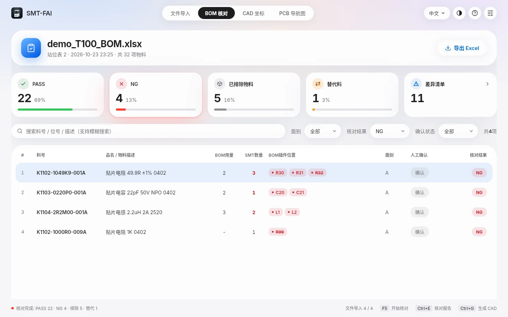

<div align="center">


# SMT-FAI

**SMT 首件检验工具：T100 BOM 与站位表自动核对，一键生成 FAI i450 坐标文件**

[](https://github.com/Marginal-Z/FAI-SMT/releases/latest)
[](https://github.com/Marginal-Z/FAI-SMT/actions/workflows/build.yml)


[官网](https://marginal-z.github.io/FAI-SMT/) · [使用教程](https://marginal-z.github.io/FAI-SMT/#tutorial) · [下载](https://github.com/Marginal-Z/FAI-SMT/releases/latest) · [更新记录](https://github.com/Marginal-Z/FAI-SMT/releases)



</div>

## 简介

SMT-FAI 面向 SMT 产线的首件检验（FAI）。导入 T100 导出的 BOM 与贴片机站位表后，软件逐料号核对插件位置、站位位号与用量，列出每一处差异及原因；核对结果与 EDA 坐标文件合并，生成 FAI i450 首件测试仪可直接导入的 CAD 坐标文件，并可在 PCB 导航图中对照实物查看。

所有文件只在本机处理，不上传任何数据。

## 主要功能

| 功能 | 说明 |
| --- | --- |
| **文件导入** | 拖入或选择 T100 BOM、站位表 A / B；自动定位表头与列，导入后立即显示文件检查结果 |
| **BOM 核对** | 结果分为 PASS、NG、已排除物料、替代料四类，NG 项逐条说明原因；支持人工确认与备注 |
| **差异清单** | 汇总 BOM、站位表 A / B、坐标文件之间的全部不一致：缺失、多余、用量、描述、坐标、面别 |
| **核对报告** | 一键导出 Excel，包含核对结果、原因、人工确认记录与备注 |
| **FAI 坐标** | 按 FAI i450 导入模板输出 CAD 文件；单位自动识别；列、表头、格式、编码可自定义 |
| **PCB 导航图** | 63 种真实元件模型按尺寸与角度绘制；2D / 3D 视图、镜像、旋转；NG 位号标框；拥挤元件自动缩小显示且坐标不变 |
| **核对规则** | 排除关键字、排除料号前缀、编程件、替代料对照表、忽略位号 |
| **使用体验** | 中文 / English / ไทย；浅色 / 深色 / 跟随系统；22 步新手引导；平板与触屏自适应；应用内自动更新 |

## 下载与安装

前往 [Releases](https://github.com/Marginal-Z/FAI-SMT/releases/latest) 或 [官网下载页](https://marginal-z.github.io/FAI-SMT/#download) 获取最新版本。

| 平台 | 系统要求 | 安装包 |
| --- | --- | --- |
| Windows | Windows 10 / 11，x64 或 ARM64 | `SMT-FAI-<版本>-windows-x64-setup.exe`（推荐）、`-arm64-setup.exe`；或 zip 绿色版 |
| Android | Android 7.0 及以上 | `SMT-FAI-<版本>-android-universal.apk`；或对应架构的 APK |
| Linux | Debian / Ubuntu 及衍生版，x64 或 ARM64 | `SMT-FAI-<版本>-linux-x64.deb`、`-arm64.deb`；或 tar.gz |

- **Windows**：安装程序按当前用户安装，无需管理员权限。安装程序暂未进行商业代码签名，如出现 SmartScreen 提示，点击「更多信息 → 仍要运行」。
- **Android**：首次安装需允许「安装未知来源应用」。
- **Linux**：`sudo apt install ./SMT-FAI-<版本>-linux-x64.deb`。

### 升级

新版本直接安装即可覆盖升级，设置与核对规则会保留。软件启动时会自动检查更新，Windows 与 Android 可在应用内下载并安装。

> Android 1.3.0 及更早版本使用临时签名，升级到 1.4.0 及以后版本前需先卸载一次旧版。此后所有版本均使用同一正式签名，证书 SHA-256 指纹见 [`docs/signing/android-cert-sha256.txt`](docs/signing/android-cert-sha256.txt)。

## 快速上手

1. **导入文件**：在「文件导入」页把 T100 BOM 与站位表 A 拖到对应卡片（双面板再导入站位表 B），确认显示「检查通过」。
2. **开始核对**：点击「开始核对」（`F5`）。在「BOM 核对」页按统计卡筛选，点击料号查看原因，核对无误后点「确认」。
3. **导出报告**：点击「导出 Excel」（`Ctrl+E`）保存核对报告。
4. **生成坐标**：在「CAD 坐标」页导入坐标文件，确认单位与格式后点「生成 CAD」（`Ctrl+G`）。
5. **对照实物**：在「PCB 导航图」页查看元件位置、按面别和核对结果着色。

完整图文教程见 [官网使用教程](https://marginal-z.github.io/FAI-SMT/#tutorial)；软件内「设置 → 使用说明」可随时查看，点击右上角问号可重新开始新手引导。

### 快捷键

| 按键 | 功能 |
| --- | --- |
| `F5` | 开始核对 |
| `Ctrl+E` | 导出核对报告 |
| `Ctrl+G` | 生成 CAD 坐标文件 |
| `F11` / `Esc` | PCB 导航图进入 / 退出全屏 |

## 输入文件要求

支持 `.xlsx`、`.csv`、`.txt`，坐标文件另支持 `.pos` 等常见 EDA 导出格式。文本文件自动识别 UTF-8 / UTF-16 / GBK 编码与分隔符。旧版 `.xls` 请先在 Excel 中另存为 `.xlsx`。

| 文件 | 需要的列 | 说明 |
| --- | --- | --- |
| T100 BOM | 料件编号、品名 / 规格、组成用量、插件位置 | 可选「替代料号」列；表头前可以有标题行 |
| 站位表 A / B | 站位、料号、物料描述、数量、位号 | 可选「关联料号」列；替代料可写在主料下一行（站位与位号留空） |
| 坐标文件 | 位号、X、Y、角度，可选面别 | 兼容 Altium、`Name / X/mm / Y/mm / Orientation / Layer` 及无表头 `位号 X Y 角度 面` 等格式 |

- 插件位置支持 `,，;；、` 与空格分隔，以及 `R1-R5`、`R1~5` 范围写法；T100 在单元格内按固定宽度插入的换行和换到下一行的续行会自动拼回。
- 坐标单位自动识别 mm / mil / inch，也可手动指定。

## 核对规则

| 情况 | 结果 |
| --- | --- |
| BOM 位号与站位表（A + B 合并）位号完全一致，且用量等于位号数 | PASS |
| 部分或全部位号由替代料贴装，其余一致 | 替代料 |
| 站位表缺少或多出位号、用量与位号数不符、位号被其他料号占用、同一位号同时出现在 A / B 面、站位表料号不在 BOM 中 | NG |
| 品名 / 规格含排除关键字（PCB、锡膏、DIP、插件、贴纸等）、料号前缀被排除、无插件位置、成品主件（用量 0），且站位表上没有该料 | 已排除物料 |
| 空白料与烧录料（品名含 烧录 / PRG / F/W）共用位号，且烧录料已上料 | 已排除物料（由烧录料贴装） |

- 替代关系来源：站位表中主料下一行的备料行、站位表「关联料号」、BOM「替代料号」列，以及「设置 → 核对规则 → 替代料」中维护的对照表（`主料号=替代料1,替代料2`）。
- Mark 点等位号可在「核对规则 → 常规 → 忽略位号」中配置，支持 `*` 通配。
- 四类结果互不重叠，数量之和等于 BOM 物料总数。

## FAI i450 坐标文件

默认输出与 FAI 程序「CAD BOM 合并导出」模板一致的 Excel 文件，每个位号一行：

| Location | X | Y | Angle | Specification | PartNo | Layer | Qty |
| --- | --- | --- | --- | --- | --- | --- | --- |
| C10 | 45.565 | 24.411 | 90 | 贴片电容 10uF 6.3V X5R 0603 | K1103-0106K0-001A | TOP | 1 |

- 同一文件既可作为 CAD 文件，也可作为 BOM 文件导入 FAI。
- 坐标单位为 mm；Specification 为 BOM 品名，PartNo 为 BOM 料号（可改为上料料号）；坐标文件无面别时按站位表 A = TOP、B = BOTTOM 补齐。
- 生成前检查位号匹配、重复位号、坐标有效性与面别一致性；存在未确认的 NG 项时会先提示。
- 点击格式旁的齿轮可调整列顺序、表头、单位、小数位、面别文字，或改为 CSV / TXT 文本格式。

## 隐私

BOM、站位表、坐标文件与报告均只在本机读取和保存。软件仅在检查更新时访问本仓库的 GitHub Releases。

## 开发

基于 Flutter（Dart）开发，界面全部自绘。

```bash
flutter pub get
flutter analyze
flutter test                                              # 单元测试
flutter test tool/screenshot_test.dart --update-goldens   # 用演示数据渲染界面截图到 tool/screens/
dart run tool/gen_demo.dart                               # 重新生成 samples/demo 演示数据
```

构建发布版：

```bash
flutter build linux --release      # 需 clang、cmake、ninja-build、libgtk-3-dev
flutter build windows --release    # 需 Visual Studio「使用 C++ 的桌面开发」
flutter build apk --release
```

### 持续集成与发布

GitHub Actions（[`build.yml`](.github/workflows/build.yml)）在每次推送时运行分析与测试，并构建全部平台：

| 平台 | 架构 | 产物 |
| --- | --- | --- |
| Windows | x64、arm64 | 安装程序 `setup.exe`、zip 绿色版 |
| Linux | x64、arm64 | `.deb`、`.tar.gz` |
| Android | armeabi-v7a、arm64-v8a、x86_64 | 各架构 APK、通用 APK、AAB |

- 开发提交先推送到 `dev`，全部构建通过后再同步到 `main`。
- 发布新版本：同步修改 `pubspec.yaml` 的 `version` 与 `lib/version.dart`，编写 `docs/release-notes/v<版本>.md`，构建通过后推送 `v<版本>` 标签，安装包自动发布到 Releases。
- 官网源码位于 [`site/`](site/)，推送到 `main` 后由 [`pages.yml`](.github/workflows/pages.yml) 自动部署到 GitHub Pages。

### 目录结构

```
lib/core/      文件解析、核对引擎、差异清单、导出、元件库（纯 Dart，可单测）
lib/ui/        界面：文件导入、BOM 核对、CAD 坐标、PCB 导航图、设置
lib/l10n/      中文 / English / ไทย 文本
samples/demo/  演示数据
site/          官网
installer/     Windows 安装程序脚本
docs/          发布说明、签名证书指纹
tool/          演示数据生成、界面截图
```

## 第三方资源

- [Inter](https://rsms.me/inter/) 字体，SIL Open Font License 1.1
- [Lucide](https://lucide.dev/) 图标图形，ISC License
- [Phosphor](https://phosphoricons.com/) 图标字体，MIT License
- [Fluent UI System Icons](https://github.com/microsoft/fluentui-system-icons)，MIT License

字体许可文本见 [`assets/fonts/`](assets/fonts/)。
